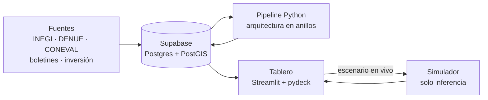
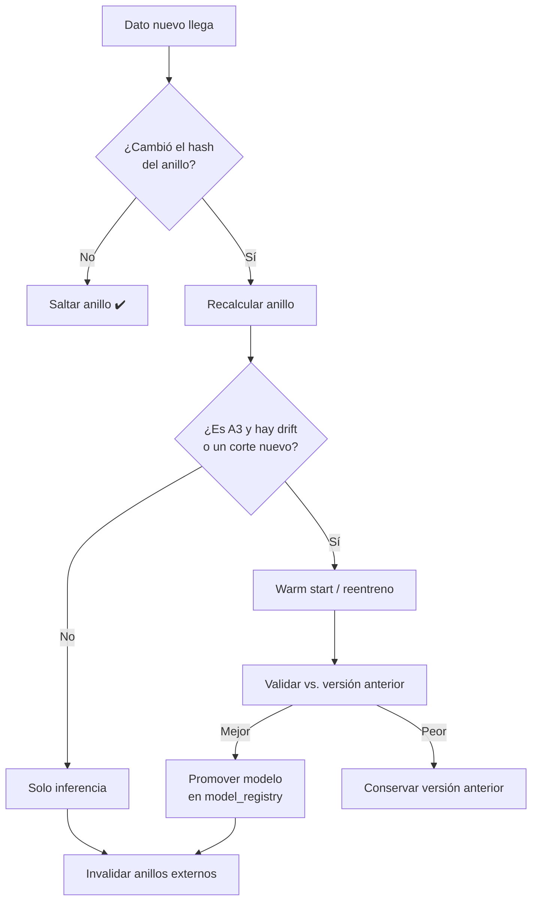

# 🧠 Arquitectura del modelo y tablero · MOPEDETU

> Cómo funciona **por detrás** el modelo en Python, cómo se **reentrena sin que salga caro** y cómo se ve el **tablero de inteligencia de negocio** para explorar y predecir rutas y circuitos turísticos en Puebla.

Relacionado: [`modelo_dimensional.md`](modelo_dimensional.md)

---

## 1. Visión en una frase

> **El usuario elige qué quiere ver (general o concreto) y el sistema le responde con un mapa, rutas, circuitos y predicciones ya calculados. El trabajo pesado ocurre antes, por capas, y cada capa solo se recalcula cuando cambian sus datos.**



---

## 2. Arquitectura en anillos (de más a menos)

Los modelos están **anillados**: cada anillo consume lo que produjo el anterior y lo guarda en Supabase. Se ordenan **de más a menos** en tres sentidos a la vez:

| Del anillo interno al externo | Va de… | a… |
|---|---|---|
| **Estabilidad** | datos que casi nunca cambian | datos que cambian cada semana o en cada clic |
| **Costo de cómputo** | caro (se calcula una vez) | barato (milisegundos) |
| **Granularidad** | estado y región | municipio, actividad y parada |

```
        ┌──────────────────────────────────────────────────────────────┐
        │ A6  Escenarios / simulación         → en vivo, en cada clic   │
        │  ┌────────────────────────────────────────────────────────┐  │
        │  │ A5  Rutas y circuitos            → nocturno / por demanda│  │
        │  │  ┌──────────────────────────────────────────────────┐  │  │
        │  │  │ A4  Índice de oportunidad + flags   → semanal       │  │  │
        │  │  │  ┌────────────────────────────────────────────┐  │  │  │
        │  │  │  │ A3  Modelo predictivo de crecimiento → anual │  │  │  │
        │  │  │  │  ┌──────────────────────────────────────┐  │  │  │  │
        │  │  │  │  │ A2  Features estructurales  → por DENUE│  │  │  │  │
        │  │  │  │  │  ┌────────────────────────────────┐  │  │  │  │  │
        │  │  │  │  │  │ A1  Base territorial → casi nunca│  │  │  │  │  │
        │  │  │  │  │  │  A0  Datos en Supabase           │  │  │  │  │  │
        │  │  │  │  │  └────────────────────────────────┘  │  │  │  │  │
        │  │  │  │  └──────────────────────────────────────┘  │  │  │  │
        │  │  │  └────────────────────────────────────────────┘  │  │  │
        │  │  └──────────────────────────────────────────────────┘  │  │
        │  └────────────────────────────────────────────────────────┘  │
        └──────────────────────────────────────────────────────────────┘
```

### Regla de oro

> **Un cambio en el anillo *k* solo invalida los anillos *k+1* en adelante, nunca los internos.**
> Un boletín nuevo recalcula la visibilidad, los flags y las rutas (A4–A6), pero **no** reentrena el modelo predictivo (A3) ni recalcula la matriz de distancias (A1).

### Detalle de cada anillo

| Anillo | Qué produce | Técnica | Se recalcula cuando… | Costo |
|---|---|---|---|---|
| **A0 Datos** | Tablas `raw.*` y `dw.*` (modelo dimensional) | ETL con pandas → Supabase | Llega un dato nuevo de una fuente | Bajo |
| **A1 Base territorial** | Geometrías, grafo vial, **matriz de tiempos 217×217** | GeoPandas, OSMnx/OSRM, NetworkX | Cambia la red carretera (≈ anual) | **Alto** (una vez) |
| **A2 Features estructurales** | Cociente de localización, predominancia, contexto social, inversión acumulada | SQL + pandas vectorizado | Nuevo corte DENUE o Censo | Medio |
| **A3 Predicción de crecimiento** | Crecimiento esperado de personal ocupado turístico por municipio × actividad | **LightGBM global** + SHAP | Nuevo corte DENUE o *drift* detectado | Medio (segundos o minutos) |
| **A4 Oportunidad y flags** | `indice_oportunidad`, flags (`OFERTA_INVISIBLE`, etc.) | Fórmula ponderada y normalizada | Semanal (scraping de boletines y reseñas) | Muy bajo |
| **A5 Rutas y circuitos** | Rutas intermunicipales y circuitos municipales con score | *Orienteering Problem* (OR-Tools) + clustering | Nocturno para configuraciones estándar; por demanda para las personalizadas | Bajo |
| **A6 Escenarios** | Predicción bajo supuestos del usuario | Inferencia del modelo A3 + re-ranking de A5 | En cada interacción del tablero | Milisegundos |

---

## 3. Por qué reentrenar no sale caro

| Estrategia | Cómo ahorra |
|---|---|
| **Huella (hash) por anillo** | Cada anillo guarda el hash de sus entradas. Si no cambió, se salta. Es como `make`, pero con datos. |
| **Un modelo global, no 20** | Un solo LightGBM con `actividad` como variable categórica en lugar de un modelo por actividad. Se entrena una vez y comparte aprendizaje entre actividades poco frecuentes. |
| **Warm start** | Con datos nuevos se continúa desde el modelo anterior (`init_model=`) en vez de entrenar desde cero. |
| **Precomputar lo estándar** | Todas las combinaciones comunes (217 municipios × ~20 actividades × 3 escenarios × 3 horizontes ≈ 40 mil filas) se calculan de noche y el tablero **solo lee**. |
| **Lo caro, una sola vez** | La matriz de tiempos (A1) es lo más costoso. Se calcula una vez y se reutiliza siempre. |
| **Inferencia, no entrenamiento, en vivo** | El simulador nunca entrena: modifica *features* y vuelve a predecir. |
| **Reentrenar por evidencia** | Monitor de *drift*: si el error en el último corte no empeora más de X %, no se reentrena. |
| **Datos pequeños** | ~217 municipios × actividades × cortes DENUE = decenas de miles de filas. Entrena en una laptop en segundos. Sin GPU ni nube cara. |



### Calendario típico

| Frecuencia | Qué corre | Anillos |
|---|---|---|
| **Cada clic** | Escenarios del simulador | A6 |
| **Nocturno** | Rutas y circuitos estándar | A5 |
| **Semanal** | Scraping de boletines y reseñas, visibilidad, flags | A0 → A4 → A5 |
| **Por publicación** | Inversión pública nueva | A0 → A2 → A4 → A5 |
| **Anual / por corte DENUE** | Features y reentreno del predictivo | A0 → A2 → A3 → … |
| **Casi nunca** | Red vial y matriz de tiempos | A1 → todo |

Orquestación: un `pipeline.py` propio con el DAG de anillos, más **GitHub Actions** con *cron* para lo semanal y nocturno. Sin infraestructura extra.

---

## 4. Los modelos por dentro

### A3 · Modelo predictivo de crecimiento

| | |
|---|---|
| **Unidad** | municipio × actividad × corte DENUE (datos panel) |
| **Objetivo (y)** | Crecimiento del personal ocupado turístico al siguiente corte: `log(PO_t+1 / PO_t)` |
| **Variables (X)** | PO y CL rezagados · visibilidad · inversión acumulada a 2 años (deflactada) · tiempo al destino consolidado más cercano · % de vía pavimentada · marginación · Pueblo Mágico · región · actividad |
| **Modelo** | LightGBM (rápido, maneja categóricas y faltantes) |
| **Línea base** | Persistencia (*"crece igual que el periodo pasado"*). Si no le ganamos, no sirve. |
| **Validación** | Temporal: entrenar con cortes antiguos y probar con el último. **Nunca** una partición aleatoria. |
| **Explicabilidad** | SHAP por municipio, para que el tablero diga *por qué* |
| **Salida** | Predicción + intervalo (regresión cuantílica p10 / p50 / p90) |

> ⚠️ **Honestidad metodológica:** el escenario *"con inversión"* es una **simulación basada en correlaciones**, no una prueba causal. En el tablero se presenta como *"escenario estimado"*.

### A4 · Índice de oportunidad

```
indice_oportunidad = w1·oferta + w2·crecimiento_pred + w3·(1 − visibilidad)
                   + w4·accesibilidad + w5·necesidad_social − w6·barrera_infra
```

Los pesos `w` son **ajustables desde el tablero** con un slider de prioridad: *económica · social · descentralización*.

### A5 · Rutas y circuitos

**Rutas intermunicipales**: se plantean como *Orienteering Problem*: maximizar el valor recogido en las paradas sin exceder un presupuesto de tiempo.

```
max  Σ score(parada)  +  bonus_coherencia_temática  +  bonus_impacto_social
s.a. tiempo_total ≤ T_max (ej. 1, 2 o 3 días)
     inicia en un municipio ANCLA (destino consolidado)
     ≥ k municipios EMERGENTES (con flag)
     actividades ∈ tema elegido (o mixtas)
```

- Grafo: nodos = (municipio, actividad); aristas = `fact_accesibilidad`.
- Solver: **OR-Tools** (rutas), con *fallback* voraz + 2-opt si hay prisa.
- Resultado: top-N rutas por tema, cada una con score, duración y municipios beneficiados.

**Circuitos municipales**: el DENUE trae **coordenadas de cada establecimiento**, así que los circuitos se arman *dentro* del municipio o en clústeres de municipios vecinos:

- **HDBSCAN** sobre coordenadas + similitud de actividades → clústeres caminables o de un día.
- Monotemáticos (solo café) o variados (café + cascadas + artesanías).

**Evolución futura (v2):** aprender los pesos del score con *learning-to-rank*, usando como ejemplos positivos rutas oficiales existentes (Pueblos Mágicos, rutas de SECTUR).

### Indicador estrella: concentración turística

Para medir la **descentralización** usamos el **índice Herfindahl-Hirschman (HHI)** del personal ocupado turístico entre municipios:

- HHI alto → turismo concentrado en pocos municipios
- El tablero muestra el **HHI actual contra el HHI proyectado** con las rutas propuestas. Es el número que cuenta la historia ante el jurado.

---

## 5. Supabase: organización

```
supabase (Postgres + PostGIS)
├── raw        → datos crudos tal cual llegan
├── dw         → modelo dimensional (dim_*, fact_*, bridge_*)
├── ml         → features, predicciones, rutas, model_registry, pipeline_runs
├── app        → vistas listas para el tablero (lectura rápida)
└── Storage    → bucket `models/` con los .joblib versionados
```

| Tabla `ml.*` | Uso |
|---|---|
| `pipeline_runs` | anillo, hash de entrada, inicio, fin, estado |
| `model_registry` | versión, métricas, fecha, ruta en Storage, `is_active` |
| `features_snapshot` | features por municipio × actividad × corte |
| `predicciones` | salida de A3 por escenario y horizonte |
| `rutas`, `ruta_paradas` | salida de A5 |

**Seguridad:**
- El tablero usa la **anon key** con RLS de solo lectura sobre el esquema `app`.
- El pipeline usa la **service key** desde secretos de GitHub o `.env`. **Nunca** se sube al repo.

---

## 6. El tablero (BI en Python)

**Stack:** `Streamlit` (páginas y filtros) + `pydeck` (mapas 3D y arcos de rutas) + `Plotly` (gráficas).

**Identidad visual:** inspirada en la **Talavera poblana**: azul cobalto, blanco, amarillo y acentos guinda. Escala secuencial de blanco a azul cobalto para el índice, y guinda para las alertas.

### Selector principal (barra lateral, siempre visible)

```
┌─────────────────────────────┐
│ 🧭 MOPEDETU                 │
│                             │
│ Modo                        │
│ (•) General   ( ) Concreto  │
│                             │
│ ¿Qué quiero predecir?       │
│ [x] Rutas   [x] Circuitos   │
│                             │
│ Actividades                 │
│ ( ) Una  (•) Varias ( ) Todas│
│ [Mezcal ✕][Café ✕][+]       │
│                             │
│ Escenario                   │
│ ▾ Tendencial                │
│   Con inversión reciente    │
│   Con inversión simulada    │
│   Con promoción (+visibil.) │
│   Combinado                 │
│                             │
│ Horizonte   [1] [3] [5] años│
│ Región      ▾ Todas         │
│ Tiempo máx. ruta ──●── 2 días│
│                             │
│ Prioridad                   │
│ Económica  ───●─── Social   │
│ Descentralización ──●──     │
└─────────────────────────────┘
```

- **Modo general:** una vista de todo el estado, todas las actividades y el mejor escenario.
- **Modo concreto:** combinaciones específicas, por ejemplo *"solo rutas de mezcal, con la inversión reciente, a 3 años, en la Mixteca"*.

### Páginas

| # | Página | Qué muestra |
|---|---|---|
| 1 | **🏠 Panorama** | KPIs, mapa coroplético de los 217 municipios y HHI actual contra proyectado |
| 2 | **🗺️ Mapa de oportunidades** | Mapa por índice o por flag, columnas 3D de personal ocupado y capas activables |
| 3 | **🧭 Rutas** | Rutas propuestas dibujadas como arcos sobre el mapa, con ranking y detalle de paradas |
| 4 | **🔁 Circuitos** | Clústeres dentro del municipio o región, con puntos DENUE y duración |
| 5 | **🔮 Simulador** | Sliders de inversión y promoción → mapa de cambio (delta) y gráfica de antes contra después |
| 6 | **🏘️ Ficha municipal** | Todo sobre un municipio: actividades, predominancia, SHAP (*por qué*), flags, inversión y rutas donde aparece |
| 7 | **💰 Inversión** | Inversión reciente contra crecimiento: dónde rinde y dónde no (`INVERSION_SIN_RETORNO`) |
| 8 | **🚩 Alertas** | Tabla filtrable de flags con exportación a CSV |

### Bosquejo: Panorama

```
┌───────────────────────────────────────────────────────────────────────────┐
│  MOPEDETU · Descentralización turística de Puebla        Escenario: Base  │
├──────────────┬──────────────┬──────────────┬──────────────┬───────────────┤
│ 217          │ 43           │ 12           │ HHI 0.31     │ +18 %         │
│ municipios   │ con flag     │ rutas        │ → 0.24 ▼     │ empleo turíst.│
│ analizados   │ OFERTA_INVIS │ propuestas   │ descentraliza│ proyectado    │
├──────────────┴──────────────┴──────────────┴──────────────┴───────────────┤
│                                                  │ Top municipios         │
│        [ MAPA DE PUEBLA ]                        │ emergentes             │
│     217 municipios coloreados por                │ 1. Tepexi ████████ .91 │
│     índice de oportunidad                        │ 2. Zapotitlán ███████  │
│     (blanco → azul talavera)                     │ 3. Cuetzalan ██████    │
│     ● destinos ancla  ◆ flags                    │ 4. …                   │
│     ⌒ arcos de rutas propuestas                  │                        │
├──────────────────────────────────────────────────┼────────────────────────┤
│ Concentración: hoy contra con rutas (barras)     │ Oportunidad por región │
│ ▇▇▇▇▇▇▇▇ Puebla capital  →  ▇▇▇▇▇▇               │ (treemap)              │
└──────────────────────────────────────────────────┴────────────────────────┘
```

### Bosquejo: Rutas

```
┌───────────────────────────────────────────────────────────────────────────┐
│ 🧭 Rutas  ·  Tema: Mezcal + Arqueológica  ·  2 días  ·  Escenario: Inversión│
├───────────────────────────────────────────────┬───────────────────────────┤
│                                               │ #1 Ruta Mixteca Ancestral │
│   [ MAPA ]                                    │ Score 0.87 · 2 días · 5 mun│
│   ● Puebla (ancla) ──⌒── Tepexi ──⌒──         │ ① Puebla      ⚓ ancla     │
│   Zapotitlán ──⌒── Caltepec ──⌒── Tehuacán    │ ② Tepexi      🏛️  1h40     │
│                                               │ ③ Zapotitlán  🌵  1h10     │
│   grosor del arco = flujo proyectado          │ ④ Caltepec    🥃  0h50 🚩  │
│   color = tema                                │ ⑤ Tehuacán    💧  1h00     │
│                                               │ Beneficia 3 mun. con alta  │
│                                               │ marginación               │
│                                               ├───────────────────────────┤
│                                               │ #2 …   #3 …   [Comparar]  │
└───────────────────────────────────────────────┴───────────────────────────┘
```

### Detalles que lo hacen verse increíble ✨

- **Mapa 3D:** columnas extruidas por personal ocupado (pydeck `ColumnLayer`) sobre el coroplético.
- **Arcos animados** para las rutas (`ArcLayer` / `TripsLayer`).
- **Comparador de escenarios lado a lado** con mapa dividido: *hoy* contra *proyectado*.
- **"¿Por qué este municipio?"**: gráfica SHAP traducida a lenguaje simple.
- **Ficha descargable** del municipio en PDF.
- **Modo oscuro** y paleta Talavera consistente en todas las gráficas.

---

## 7. Estructura del código

```
MOPEDETU/
├── data/
│   ├── raw/                     # descargas (no se versionan)
│   └── geo/                     # GeoJSON de municipios de Puebla
├── mopedetu/                    # paquete Python
│   ├── config.py                # pesos, umbrales y rutas; lee .env
│   ├── db.py                    # cliente Supabase / SQLAlchemy
│   ├── etl/                     # A0: extract_*.py, load_*.py
│   ├── rings/
│   │   ├── base.py              # clase Ring: hash, skip, run, invalidate
│   │   ├── a1_territorio.py
│   │   ├── a2_features.py
│   │   ├── a3_prediccion.py
│   │   ├── a4_oportunidad.py
│   │   ├── a5_rutas.py
│   │   └── a6_escenarios.py
│   ├── models/registry.py       # guardar/cargar modelos en Storage
│   └── pipeline.py              # orquestador del DAG de anillos
├── dashboard/
│   ├── app.py                   # Streamlit (entrada)
│   ├── pages/                   # 1_Panorama.py … 8_Alertas.py
│   ├── components/              # mapas, KPIs, tarjetas de ruta
│   └── theme.py                 # paleta Talavera
├── notebooks/                   # exploración
├── tests/
├── .github/workflows/           # cron semanal / nocturno
├── requirements.txt
└── .env.example
```

Contrato de cada anillo (todos iguales y fáciles de mantener):

```python
class Ring:
    name: str
    depends_on: list[str]

    def input_hash(self) -> str: ...   # hash de las tablas de entrada
    def run(self) -> None: ...         # calcula y escribe en Supabase
    def is_stale(self) -> bool:        # ¿hay que recalcular?
        return self.input_hash() != last_successful_hash(self.name)
```

```bash
python -m mopedetu.pipeline              # corre solo lo que cambió
python -m mopedetu.pipeline --from a4    # fuerza desde el anillo 4
streamlit run dashboard/app.py
```

---

## 8. Plan por fases (hackathon)

| Fase | Entregable | Mínimo viable |
|---|---|---|
| **1. Datos** | Supabase con `dim_municipio`, DENUE, contexto social y GeoJSON | ✅ |
| **2. Índice** | A2 + A4: CL, flags y mapa coroplético | ✅ |
| **3. Rutas** | A1 + A5: matriz de tiempos y rutas por tema | ✅ |
| **4. Tablero** | Panorama, Mapa, Rutas y Ficha | ✅ |
| **5. Predicción** | A3 con dos o más cortes DENUE + SHAP | ⭐ |
| **6. Simulador** | A6 + escenarios + HHI proyectado | ⭐ |

✅ = imprescindible para la demo · ⭐ = lo que hace ganar

---

## 9. Riesgos y mitigación

| Riesgo | Mitigación |
|---|---|
| Pocos cortes DENUE comparables | Usar 2019, 2020 y años posteriores; si no alcanza, A3 se reduce a un índice y la predicción se marca como experimental |
| Inversión pública dispersa o en PDF | Empezar por una muestra de programas grandes y documentar la cobertura |
| Matriz de tiempos lenta (API con límites) | Calcularla una vez con OSRM local o con distancia × velocidad por tipo de vía |
| Scraping de boletines frágil | Guardar HTML crudo en `raw` y parsear aparte; si falla, usar el valor de la semana pasada |
| El escenario "con inversión" se interpreta como causal | Etiquetarlo como *estimado* y mostrar intervalos |
