# 🧱 Modelo dimensional · MOPEDETU

> Propuesta de base de datos analítica para el **Modelo Predictivo de Descentralización Turística de Puebla**.
> Enfoque: **esquema de constelación** (varias tablas de hechos que comparten dimensiones conformadas), metodología Kimball.

---

## 1. Objetivo del modelo

Responder preguntas como:

- ¿Qué actividades turísticas **predominan** en cada municipio y con cuánto personal ocupado?
- ¿Dónde hay **oferta real** (unidades económicas y empleo) pero **poca visibilidad** en boletines, prensa y redes? → *flag de oportunidad*
- ¿Cómo se relaciona la **inversión pública** y la **infraestructura vial** con el crecimiento turístico?
- ¿Qué municipios pueden conectarse en **rutas intermunicipales** (mezcal, café, arqueológica…) o **circuitos municipales**?
- ¿Qué municipios **crecerán** en empleo turístico? (salida del modelo predictivo)

---

## 2. Vista general

```mermaid
erDiagram
    dim_municipio ||--o{ fact_unidades_economicas : ""
    dim_municipio ||--o{ fact_especializacion : ""
    dim_municipio ||--o{ fact_contexto_social : ""
    dim_municipio ||--o{ fact_visibilidad : ""
    dim_municipio ||--o{ fact_inversion : ""
    dim_municipio ||--o{ fact_infraestructura : ""
    dim_municipio ||--o{ fact_accesibilidad : "origen/destino"
    dim_municipio ||--o{ fact_flag_oportunidad : ""
    dim_municipio ||--o{ fact_ruta_parada : ""
    dim_municipio ||--o{ fact_prediccion : ""

    dim_actividad ||--o{ fact_especializacion : ""
    dim_actividad ||--o{ fact_visibilidad : ""
    dim_actividad ||--o{ fact_flag_oportunidad : ""
    dim_actividad ||--o{ fact_ruta_parada : ""
    dim_actividad ||--o{ fact_prediccion : ""
    dim_actividad ||--o{ bridge_scian_actividad : ""
    dim_scian ||--o{ bridge_scian_actividad : ""
    dim_scian ||--o{ fact_unidades_economicas : ""
    dim_estrato_personal ||--o{ fact_unidades_economicas : ""

    dim_tiempo ||--o{ fact_unidades_economicas : ""
    dim_tiempo ||--o{ fact_inversion : ""
    dim_tiempo ||--o{ fact_visibilidad : ""
    dim_tiempo ||--o{ fact_contexto_social : ""

    dim_fuente ||--o{ fact_visibilidad : ""
    dim_fuente ||--o{ fact_inversion : ""
    dim_programa_inversion ||--o{ fact_inversion : ""
    dim_tipo_via ||--o{ fact_infraestructura : ""
    dim_tipo_flag ||--o{ fact_flag_oportunidad : ""
    dim_ruta ||--o{ fact_ruta_parada : ""
```



---

## 3. Dimensiones

### 🗺️ `dim_municipio`
Dimensión central (conformada). Puebla tiene **217 municipios** (clave de entidad `21`).

| Columna | Tipo | Descripción |
|---|---|---|
| `municipio_sk` | INT PK | Llave subrogada |
| `cve_geo` | CHAR(5) | Clave INEGI completa, ej. `21114` (Puebla) |
| `cve_ent` | CHAR(2) | `21` |
| `cve_mun` | CHAR(3) | ej. `114` |
| `nombre` | VARCHAR | Nombre oficial |
| `region` | VARCHAR | Región socioeconómica (Sierra Norte, Sierra Nororiental, Valle de Serdán, Angelópolis, Valle de Atlixco y Matamoros, Mixteca, Tehuacán y Sierra Negra) |
| `es_pueblo_magico` | BOOL | Pertenece al programa Pueblos Mágicos |
| `es_destino_consolidado` | BOOL | Polo turístico actual (ancla para rutas) |
| `latitud`, `longitud` | DECIMAL | Centroide de la cabecera |
| `superficie_km2` | DECIMAL | |
| `geom` | GEOMETRY | Polígono (si usamos PostGIS) |

### 🥾 `dim_actividad`
Catálogo de actividades turísticas propias del proyecto.

| Columna | Tipo | Descripción |
|---|---|---|
| `actividad_sk` | INT PK | |
| `nombre` | VARCHAR | ej. *Mezcal*, *Café*, *Zona arqueológica*, *Talavera* |
| `categoria` | VARCHAR | Cultural · Naturaleza · Gastronómica · Religiosa · Aventura · Artesanal · Rural/comunitaria |
| `subcategoria` | VARCHAR | |
| `tema_ruta` | VARCHAR | Tema con el que puede formar ruta (ej. `mezcal`, `cafe`, `arqueologica`) |
| `descripcion` | TEXT | |

### 🏷️ `dim_scian`
Clasificación de actividades económicas del DENUE.

| Columna | Tipo | Descripción |
|---|---|---|
| `scian_sk` | INT PK | |
| `codigo_scian` | CHAR(6) | ej. `721111` (hoteles), `312142` (destilación de mezcal) |
| `descripcion` | VARCHAR | |
| `sector`, `subsector`, `rama` | VARCHAR | Jerarquía SCIAN |
| `es_turistico` | BOOL | Pertenece a actividades características del turismo |

### 🔗 `bridge_scian_actividad`
Relación **muchos a muchos** entre códigos SCIAN y actividades turísticas (un restaurante puede alimentar *gastronomía* y *Pueblo Mágico*; el mezcal puede ser *gastronómica* y *ruta del mezcal*).

| Columna | Tipo | Descripción |
|---|---|---|
| `scian_sk` | FK | |
| `actividad_sk` | FK | |
| `peso` | DECIMAL | Factor de asignación (suma 1 por SCIAN) |

### 👥 `dim_estrato_personal`
El DENUE reporta el personal ocupado **en rangos**, no como número exacto.

| Columna | Tipo | Ejemplo |
|---|---|---|
| `estrato_sk` | INT PK | |
| `rango_texto` | VARCHAR | `6 a 10 personas` |
| `minimo` | INT | 6 |
| `maximo` | INT | 10 |
| `punto_medio` | DECIMAL | 8 → valor usado para estimar personal |

### 📅 `dim_tiempo`
| Columna | Tipo | Descripción |
|---|---|---|
| `tiempo_sk` | INT PK | `AAAAMMDD` |
| `fecha` | DATE | |
| `anio`, `trimestre`, `mes` | INT | |
| `temporada` | VARCHAR | Alta / Media / Baja |
| `es_periodo_vacacional` | BOOL | Semana Santa, verano, diciembre… |
| `corte_denue` | VARCHAR | ej. `2019-11`, `2024-05` (nulo si no aplica) |

### 📰 `dim_fuente`
Origen de cada dato (para trazabilidad y para medir visibilidad).

| Columna | Tipo | Descripción |
|---|---|---|
| `fuente_sk` | INT PK | |
| `nombre` | VARCHAR | INEGI, DATATUR, Secretaría de Turismo Puebla, periódico X, Google Maps… |
| `tipo` | VARCHAR | Oficial · Boletín · Prensa · Redes sociales · Reseñas · Transparencia |
| `institucion` | VARCHAR | |
| `url_base` | VARCHAR | |
| `confiabilidad` | TINYINT | 1–5 |

### 💰 `dim_programa_inversion`
| Columna | Tipo | Descripción |
|---|---|---|
| `programa_sk` | INT PK | |
| `nombre_programa` | VARCHAR | |
| `orden_gobierno` | VARCHAR | Federal · Estatal · Municipal |
| `dependencia` | VARCHAR | SECTUR, SIT Puebla, etc. |
| `rubro` | VARCHAR | Infraestructura turística · Carreteras · Promoción · Imagen urbana · Capacitación |

### 🛣️ `dim_tipo_via`
| Columna | Tipo | Descripción |
|---|---|---|
| `tipo_via_sk` | INT PK | |
| `tipo` | VARCHAR | Autopista · Carretera federal · Carretera estatal · Camino rural · Terracería · Brecha |
| `superficie` | VARCHAR | Pavimentada · Revestida · Sin revestir |
| `velocidad_ref_kmh` | INT | Para estimar tiempos de traslado |

### 🚩 `dim_tipo_flag`
| Columna | Tipo | Descripción |
|---|---|---|
| `tipo_flag_sk` | INT PK | |
| `codigo` | VARCHAR | ver sección 5 |
| `descripcion` | VARCHAR | |
| `prioridad` | TINYINT | |

### 🧭 `dim_ruta`
| Columna | Tipo | Descripción |
|---|---|---|
| `ruta_sk` | INT PK | |
| `nombre` | VARCHAR | ej. *Ruta del Mezcal Mixteco* |
| `tipo` | VARCHAR | `ruta_intermunicipal` · `circuito_municipal` |
| `tema` | VARCHAR | mezcal · café · arqueológica · conventos · sidra · mixta |
| `es_monotematica` | BOOL | Una sola actividad o variada |
| `duracion_estimada_h` | DECIMAL | |
| `num_municipios` | INT | |
| `origen` | VARCHAR | `existente` · `propuesta_modelo` |

---

## 4. Tablas de hechos

| # | Tabla | Granularidad (una fila =) | Tipo |
|---|---|---|---|
| 1 | `fact_unidades_economicas` | municipio × SCIAN × estrato × corte DENUE | Transaccional agregada |
| 2 | `fact_especializacion` | municipio × actividad × año | Snapshot calculado |
| 3 | `fact_contexto_social` | municipio × año | Snapshot periódico |
| 4 | `fact_visibilidad` | municipio × actividad × fuente × mes | Transaccional agregada |
| 5 | `fact_inversion` | municipio × programa × fuente × fecha (× actividad opcional) | Transaccional |
| 6 | `fact_infraestructura` | municipio × tipo de vía × año | Snapshot periódico |
| 7 | `fact_accesibilidad` | municipio origen × municipio destino | Sin hechos temporales (matriz) |
| 8 | `fact_flag_oportunidad` | municipio × actividad × tipo de flag × versión | Snapshot calculado |
| 9 | `fact_ruta_parada` | ruta × parada (municipio + actividad) | Factless / puente |
| 10 | `fact_prediccion` | municipio × actividad × horizonte × versión del modelo | Snapshot calculado |

### 1️⃣ `fact_unidades_economicas` (DENUE)
| Columna | Tipo | Descripción |
|---|---|---|
| `municipio_sk`, `scian_sk`, `estrato_sk`, `tiempo_sk` | FK | |
| `num_unidades` | INT | Establecimientos |
| `personal_ocupado_est` | DECIMAL | `num_unidades × punto_medio` |

### 2️⃣ `fact_especializacion` → **predominancia**
| Columna | Tipo | Descripción |
|---|---|---|
| `municipio_sk`, `actividad_sk`, `tiempo_sk` | FK | |
| `unidades` | INT | |
| `personal_ocupado` | DECIMAL | |
| `participacion_estatal` | DECIMAL | % del personal estatal de esa actividad |
| `cociente_localizacion` | DECIMAL | Ver fórmula abajo |
| `nivel_predominancia` | VARCHAR | Alta (CL ≥ 1.5) · Media (1–1.5) · Baja (< 1) |
| `ranking_estatal` | INT | |

**Cociente de localización (CL):**

```
CL(m, a) = (PO de la actividad a en m / PO total de m) / (PO de la actividad a en Puebla / PO total de Puebla)
```

Si CL > 1, el municipio está **especializado** en esa actividad respecto al estado.

### 3️⃣ `fact_contexto_social`
| Columna | Tipo | Fuente |
|---|---|---|
| `municipio_sk`, `tiempo_sk` | FK | |
| `poblacion_total` | INT | Censo INEGI |
| `indice_marginacion`, `grado_marginacion` | DECIMAL / VARCHAR | CONAPO |
| `indice_rezago_social` | DECIMAL | CONEVAL |
| `pct_pobreza` | DECIMAL | CONEVAL |
| `pct_poblacion_indigena` | DECIMAL | INEGI |
| `tasa_incidencia_delictiva` | DECIMAL | SESNSP |
| `pct_viviendas_internet` | DECIMAL | INEGI |
| `poblacion_ocupada` | INT | |

### 4️⃣ `fact_visibilidad`
Mide **cuánto se habla** de una actividad en un municipio.

| Columna | Tipo | Descripción |
|---|---|---|
| `municipio_sk`, `actividad_sk`, `fuente_sk`, `tiempo_sk` | FK | |
| `num_menciones` | INT | Boletines, notas, publicaciones |
| `num_resenas` | INT | Google Maps / TripAdvisor |
| `rating_promedio` | DECIMAL | |
| `sentimiento_promedio` | DECIMAL | −1 a 1 (opcional, NLP) |
| `menciones_por_10k_hab` | DECIMAL | Normalizado por población |

### 5️⃣ `fact_inversion`
| Columna | Tipo | Descripción |
|---|---|---|
| `municipio_sk`, `programa_sk`, `fuente_sk`, `tiempo_sk` | FK | |
| `actividad_sk` | FK nullable | Si la inversión apunta a una actividad concreta |
| `monto_mxn` | DECIMAL | Nominal |
| `monto_mxn_real` | DECIMAL | Deflactado con INPC (año base fijo) |
| `num_proyectos` | INT | |
| `monto_per_capita` | DECIMAL | |

### 6️⃣ `fact_infraestructura`
| Columna | Tipo | Descripción |
|---|---|---|
| `municipio_sk`, `tipo_via_sk`, `tiempo_sk` | FK | |
| `km_via` | DECIMAL | Red Nacional de Caminos (INEGI) |
| `densidad_vial_km_km2` | DECIMAL | |
| `cuartos_hotel` | INT | DATATUR / DENUE 721 |
| `num_establecimientos_hospedaje` | INT | |

### 7️⃣ `fact_accesibilidad`
Matriz origen-destino: **las aristas del grafo** para construir rutas.

| Columna | Tipo | Descripción |
|---|---|---|
| `municipio_origen_sk` | FK → `dim_municipio` | *Role-playing* |
| `municipio_destino_sk` | FK → `dim_municipio` | *Role-playing* |
| `distancia_km` | DECIMAL | Por carretera |
| `tiempo_min` | DECIMAL | |
| `pct_via_pavimentada` | DECIMAL | Calidad del trayecto |
| `es_colindante` | BOOL | |

### 8️⃣ `fact_flag_oportunidad`
| Columna | Tipo | Descripción |
|---|---|---|
| `municipio_sk`, `actividad_sk`, `tipo_flag_sk`, `tiempo_sk` | FK | |
| `score_oferta` | DECIMAL 0–1 | CL + personal ocupado |
| `score_visibilidad` | DECIMAL 0–1 | Menciones normalizadas |
| `score_inversion` | DECIMAL 0–1 | |
| `score_accesibilidad` | DECIMAL 0–1 | Tiempo a destinos consolidados |
| `score_social` | DECIMAL 0–1 | Necesidad social (marginación) |
| `indice_oportunidad` | DECIMAL 0–1 | Combinación ponderada |
| `flag_activo` | BOOL | |
| `version_calculo` | VARCHAR | Para comparar ponderaciones |

### 9️⃣ `fact_ruta_parada`
| Columna | Tipo | Descripción |
|---|---|---|
| `ruta_sk`, `municipio_sk`, `actividad_sk` | FK | |
| `orden_parada` | INT | 1, 2, 3… |
| `tiempo_desde_anterior_min` | DECIMAL | |
| `distancia_desde_anterior_km` | DECIMAL | |
| `es_ancla` | BOOL | Destino consolidado que atrae el flujo |
| `es_emergente` | BOOL | Municipio con flag de oportunidad |
| `estancia_sugerida_h` | DECIMAL | |

### 🔟 `fact_prediccion`
| Columna | Tipo | Descripción |
|---|---|---|
| `municipio_sk`, `actividad_sk`, `tiempo_sk` | FK | `tiempo_sk` = horizonte predicho |
| `personal_ocupado_pred` | DECIMAL | |
| `crecimiento_pred_pct` | DECIMAL | |
| `intervalo_inf`, `intervalo_sup` | DECIMAL | |
| `escenario` | VARCHAR | `base` · `con_inversion` · `con_ruta` |
| `version_modelo` | VARCHAR | |

---

## 5. Flags de área de oportunidad

| Código | Condición (borrador) | Significado |
|---|---|---|
| `OFERTA_INVISIBLE` | CL ≥ 1.5 **y** personal ocupado alto **y** visibilidad baja | Hay actividad real y nadie la promociona. **Flag principal.** |
| `OFERTA_SIN_INVERSION` | CL alto **y** inversión per cápita baja | Potencial sin respaldo público |
| `INVERSION_SIN_RETORNO` | Inversión alta **y** crecimiento de personal bajo | Revisar efectividad |
| `ACCESIBLE_NO_EXPLOTADO` | Cerca de un destino consolidado (< 60 min) **y** visibilidad baja | Candidato a extensión de ruta |
| `BARRERA_INFRAESTRUCTURA` | CL alto **y** % de vía pavimentada bajo | Necesita caminos antes que promoción |
| `IMPACTO_SOCIAL` | Flag activo **y** marginación alta/muy alta | Prioridad de descentralización |

Los umbrales (percentiles, CL ≥ 1.5, < 60 min) se calibran con los datos reales.

---

## 6. Matriz de bus (dimensiones × hechos)

| Hecho \ Dimensión | Municipio | Actividad | SCIAN | Estrato | Tiempo | Fuente | Programa | Tipo vía | Tipo flag | Ruta |
|---|:-:|:-:|:-:|:-:|:-:|:-:|:-:|:-:|:-:|:-:|
| unidades_economicas | ✅ | (bridge) | ✅ | ✅ | ✅ | | | | | |
| especializacion | ✅ | ✅ | | | ✅ | | | | | |
| contexto_social | ✅ | | | | ✅ | | | | | |
| visibilidad | ✅ | ✅ | | | ✅ | ✅ | | | | |
| inversion | ✅ | ○ | | | ✅ | ✅ | ✅ | | | |
| infraestructura | ✅ | | | | ✅ | | | ✅ | | |
| accesibilidad | ✅✅ | | | | | | | | | |
| flag_oportunidad | ✅ | ✅ | | | ✅ | | | | ✅ | |
| ruta_parada | ✅ | ✅ | | | | | | | | ✅ |
| prediccion | ✅ | ✅ | | | ✅ | | | | | |

✅ obligatoria · ○ opcional · ✅✅ role-playing (origen y destino)

---

## 7. Flujo de carga (ETL)

```
 staging (crudos)                  dimensiones                 hechos base                     hechos calculados
 ─────────────────                 ───────────                 ───────────                     ─────────────────
 DENUE csv          ─┐
 Censo / CONAPO     ─┤             dim_municipio               fact_unidades_economicas  ──►   fact_especializacion
 CONEVAL            ─┤──► limpieza dim_scian + bridge   ──►    fact_contexto_social      ──►   fact_flag_oportunidad
 Boletines (scraping)┤             dim_actividad               fact_visibilidad          ──►   fact_prediccion
 Transparencia      ─┤             dim_tiempo …                fact_inversion            ──►   fact_ruta_parada
 Red Nal. Caminos   ─┘                                         fact_infraestructura / accesibilidad
```

1. **Staging:** archivos crudos tal cual (`data/raw/`).
2. **Dimensiones:** primero `dim_municipio` (llave de todo) y los catálogos.
3. **Hechos base:** datos observados.
4. **Hechos calculados:** CL, flags, predicciones y rutas; se versionan para comparar corridas.

---

## 8. Consultas de ejemplo

**Top oportunidades "invisibles":**

```sql
SELECT m.nombre, a.nombre AS actividad, f.indice_oportunidad,
       f.score_oferta, f.score_visibilidad
FROM fact_flag_oportunidad f
JOIN dim_municipio m  USING (municipio_sk)
JOIN dim_actividad a  USING (actividad_sk)
JOIN dim_tipo_flag t  USING (tipo_flag_sk)
WHERE t.codigo = 'OFERTA_INVISIBLE' AND f.flag_activo
ORDER BY f.indice_oportunidad DESC
LIMIT 20;
```

**Predominancia por municipio:**

```sql
SELECT m.nombre, a.nombre, e.cociente_localizacion, e.nivel_predominancia
FROM fact_especializacion e
JOIN dim_municipio m USING (municipio_sk)
JOIN dim_actividad a USING (actividad_sk)
WHERE e.nivel_predominancia = 'Alta'
ORDER BY m.nombre, e.cociente_localizacion DESC;
```

**Municipios emergentes a menos de 90 min de un destino consolidado:**

```sql
SELECT o.nombre AS ancla, d.nombre AS emergente, ac.tiempo_min
FROM fact_accesibilidad ac
JOIN dim_municipio o ON o.municipio_sk = ac.municipio_origen_sk AND o.es_destino_consolidado
JOIN dim_municipio d ON d.municipio_sk = ac.municipio_destino_sk
WHERE ac.tiempo_min < 90
  AND EXISTS (SELECT 1 FROM fact_flag_oportunidad f
              WHERE f.municipio_sk = d.municipio_sk AND f.flag_activo);
```

---

## 9. Tecnología sugerida

| Opción | Cuándo |
|---|---|
| **PostgreSQL + PostGIS** | Recomendado: mapas, distancias y polígonos nativos |
| **DuckDB / SQLite** | Prototipo rápido en local, sin servidor |

Convenciones: tablas en `snake_case`, prefijos `dim_`, `fact_`, `bridge_`; llaves subrogadas `*_sk`; claves naturales (`cve_geo`, `codigo_scian`) conservadas como atributos.
